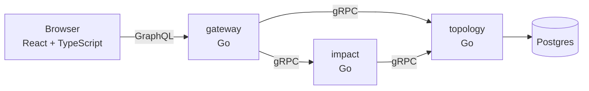

# Lightpath

**When a fibre site goes down, who actually loses service, and which ISPs need to be told?**

On an open access network, many ISPs sell subscriptions over the same fibre. When an access site
fails, the naive answer is "everyone behind it". The real answer depends on topology: a cabinet
with a second fibre to a neighbouring site stays up, and a dual-homed business customer keeps
service through its secondary cabinet. Lightpath computes the real answer from the network graph
and shows it as light moving through the network.

- Take down any site on the map, or several at once.
- See how many customers have lost service and how many stay online only because traffic was
  rerouted.
- Get the list of ISPs to notify, most affected first.
- Share a scenario as a link: `/?down=acc-ali,agg-ost`.

The demo network is a fictional open access network laid over Umeå: two core sites, four
aggregation sites, eight access sites, sixteen street cabinets and about 1,500 customers across
four invented ISPs. Redundancy is deliberately uneven so each outage tells a different story.

## Architecture



| Service    | Responsibility                                                                    |
| ---------- | --------------------------------------------------------------------------------- |
| `topology` | Owns the network: sites, fibre, ISPs, customers. Migrates and seeds Postgres.     |
| `impact`   | Applies failures to a cached topology snapshot and computes who loses service.     |
| `gateway`  | GraphQL for the browser. Translates queries to gRPC, serves the built frontend.    |

The contract between services is `proto/lightpath/v1/lightpath.proto`. The browser contract is
`internal/gateway/schema.graphql`.

### How impact is computed

The network is an undirected graph. Analysis runs two breadth-first searches from the core sites:
one on the intact network, which gives every site its normal path, and one with the failed sites
removed, which tells what can still reach a core.

- A site with no remaining path is **isolated**.
- A site that can reach a core, but whose normal path ran through a failed site, is **rerouted**.
- A customer is **affected** if none of its cabinets has service, and **rerouted** if it has service
  but not through its primary cabinet's normal path.
- Street cabinets are passive: they can be reached, but traffic never transits through them. A
  cabinet spliced to two access sites must not make those sites look connected to each other.

It is O(nodes + links + customers) per request, about a millisecond for the demo network.

## Run it

You need Go 1.24+, Node 22+, [buf](https://buf.build/docs/installation) and Docker.

```bash
make setup   # generate gRPC code, go mod tidy, npm install
make test    # Go tests with the race detector, frontend tests
make up      # whole stack in Docker on http://localhost:8080
```

Without Docker, `make dev` runs the three Go services with an in-memory topology and the Vite
dev server on http://localhost:5173.

`make help` lists everything else.

## Deploy to AWS

The cheapest sensible home is one [Lightsail](https://aws.amazon.com/lightsail/) instance running
the compose stack, with Caddy in front for HTTPS.

1. Create a Lightsail instance: Ubuntu 24.04, the 2 GB plan. In its networking tab, open
   ports 80 and 443.
2. Attach a static IP, and point a DNS A record (for example `lightpath.yourdomain.se`) at it.
3. SSH in and run `deploy/lightsail-setup.sh`. It adds swap and installs Docker.
4. Clone the repo and start it:

   ```bash
   DOMAIN=lightpath.yourdomain.se POSTGRES_PASSWORD='something-long' make deploy
   ```

Caddy fetches a certificate on first request. Set a billing alarm in AWS before anything else.

## Decisions and trade-offs

**Topology is cached in the impact service, with a stale fallback.** An outage is exactly when
other systems are struggling. If the topology service is unreachable, impact keeps answering from
the last known snapshot and marks the answer `stale`; the UI says so. Without a snapshot it
returns `UNAVAILABLE` instead of guessing. The cache refresh holds a lock so a burst of requests
after expiry triggers one fetch, not one each.

**Bad input is an error, not a silent skip.** An unknown site id returns `INVALID_ARGUMENT`. An
operator who mistyped a site should find out, not get a reassuringly small number.

**Data from other services is validated at the boundary.** Topology is checked for referential
integrity when loaded from Postgres and again when received over gRPC. An inconsistent snapshot
is rejected and not cached.

**Retries live in the gRPC service config.** Both RPCs are reads, so retrying `UNAVAILABLE` with
backoff is safe. Every call also has a deadline.

**Business logic stays out of the gateway.** It translates and maps errors; it decides nothing.
The frontend computes which fibre glows, for drawing only. Every number on screen comes from the
impact service.

**Link order means something.** When two paths are equally short, a site's first listed uplink
is its primary. That keeps "normal path" deterministic and matches how networks are documented.

**Postgres for topology.** It is relational data with integrity rules, and Postgres is VX's
direction of travel. The schema is small and migrations run on start; a real system would use a
migration tool.

## What I would build next

- **Automatic activation with Temporal.** An ISP sells subscriptions in an area before the network
  is ready. A workflow waits for the handover signal, then activates every pending subscription,
  with retries per subscription and a clear record of what happened.
- **Live outages from network events** instead of manual selection, and notifications pushed to
  each ISP with only their own customers.
- **Path-level detail**: which fibre a rerouted customer now uses, and how much spare capacity it
  has.
- **OpenTelemetry tracing** across gateway, impact and topology, and metrics for analysis latency
  and cache staleness.
- **Nomad, Consul and Vault** in place of compose once there is more than one machine.

## Repository

```
cmd/                 one main package per service
internal/network     domain model, validation, demo seed
internal/impact      the outage analysis (pure, no I/O)
internal/impactsvc   caching, stale fallback, input limits
internal/topology    stores: in-memory and Postgres
internal/rpc         protobuf conversion, gRPC servers, client setup
internal/gateway     GraphQL schema, resolvers, HTTP server
proto/               gRPC contract
web/                 React + TypeScript frontend
deploy/              Caddy and Lightsail setup
```

Built with Claude Code as a pair. See `CLAUDE.md` for the rules the agent works under.
