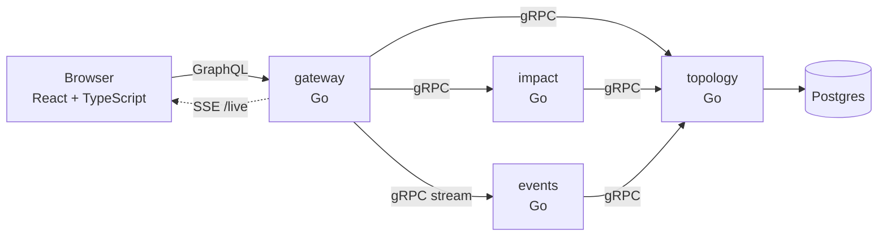

# Lightpath

**When a fibre site goes down, who actually loses service, and which ISPs need to be told?**

On an open access network, many ISPs sell subscriptions over the same fibre. When an access site
fails, the naive answer is "everyone behind it". The real answer depends on topology: a cabinet
with a second fibre to a neighbouring site stays up, and a dual-homed business customer keeps
service through its secondary cabinet. Lightpath computes the real answer from the network graph
and shows it as light moving through the network.

- Watch the network live: sites fail and recover on their own, and a feed says what each event
  did to customers ("Ålidhem access site went down. 76 customers lost service, 104 on backup
  paths.").
- Switch to the sandbox and take down any site on the map, or several at once. The sandbox starts
  from what is down live, so you can ask "what if this fails too?"
- See how many customers have lost service and how many stay online only because traffic was
  rerouted.
- Get the list of ISPs to notify, most affected first.
- Share a scenario as a link: `/?down=acc-ali,agg-ost`. A shared link opens the sandbox.

The demo network is a fictional open access network laid over Umeå: two core sites, four
aggregation sites, eight access sites, sixteen street cabinets and about 1,500 customers across
four invented ISPs. Redundancy is deliberately uneven so each outage tells a different story.

## Architecture



| Service    | Responsibility                                                                    |
| ---------- | --------------------------------------------------------------------------------- |
| `topology` | Owns the network: sites, fibre, ISPs, customers. Migrates and seeds Postgres.     |
| `impact`   | Applies failures to a cached topology snapshot and computes who loses service.     |
| `events`   | Owns the live state: which sites are down now. Runs the simulator, streams changes. |
| `gateway`  | GraphQL for the browser, SSE for the live view. Translates to gRPC, serves the frontend. |

The contract between services is `proto/lightpath/v1/lightpath.proto`. The browser contract is
`internal/gateway/schema.graphql`, plus the JSON messages on `/live`.

### How live mode works

1. The simulator (`internal/events/sim`) decides that a site fails or recovers and emits an
   event with an id.
2. The events service checks the site against the topology, applies the event to its state and,
   if anything changed, hands the new state to a broker that fans it out to every subscriber.
3. The gateway holds one `WatchState` stream per open browser tab and forwards each update as a
   server-sent event: the sequence number, the sites down and the event that caused it.
4. The browser draws the new state and asks the gateway for `outage(failedNodeIds,
   baselineNodeIds)`, with the state before and after the event. The impact service compares the
   two customer by customer, and the feed shows that event's own effect: lost, regained and
   rerouted.

A new subscriber always gets the full current state first, so a reconnecting tab never has to
replay history.

### How impact is computed

The network is an undirected graph. Analysis runs two breadth-first searches from the core sites:
one on the intact network, which gives every site its normal path, and one with the failed sites
removed, which tells what can still reach a core.

- A site with no remaining path is **isolated**.
- A site that can reach a core, but whose normal path ran through a failed site, is **rerouted**.
- A customer is **affected** if none of its cabinets has service, and **rerouted** if it has service
  but not through its primary cabinet's normal path.
- Street cabinets are passive: they can be reached, but traffic never transits through them. A
  cabinet spliced to two access sites must not make those sites look connected to each other.

It is O(nodes + links + customers) per request, about a millisecond for the demo network.

## Run it

You need Go 1.24+, Node 22+, [buf](https://buf.build/docs/installation) and Docker.

```bash
make setup   # generate gRPC code, go mod tidy, npm install
make test    # Go tests with the race detector, frontend tests
make up      # whole stack in Docker on http://localhost:8080
```

`make e2e` runs the browser tests in `web/e2e` with Playwright. It starts its own copy of the
services on unusual ports, so it does not need Docker and does not clash with `make dev` or
`make up`. The first time, install the browser with `cd web && npx playwright install chromium`.

Without Docker, `make dev` runs the four Go services with an in-memory topology and the Vite
dev server on http://localhost:5173.

### Live mode

`make up` and `make dev` start in live mode. The events service reads these variables:

| Variable             | Default | Meaning                                                        |
| -------------------- | ------- | -------------------------------------------------------------- |
| `LIGHTPATH_MODE`     | `demo`  | `live` runs the simulator; `demo` keeps everything up.         |
| `SIM_INTERVAL`       | `3m`    | Average time between failures.                                 |
| `SIM_MEAN_REPAIR`    | `6m`    | Average time until a failed site is back.                      |
| `SIM_MAX_CONCURRENT` | `3`     | Most sites down at once. A failure beyond this is skipped.     |

The code defaults to `demo` so that nothing fails unless someone asked for it; compose and the
Makefile ask for `live`. To watch it move faster:

```bash
LIGHTPATH_MODE=live SIM_INTERVAL=10s SIM_MEAN_REPAIR=30s make dev
```

`make up` takes `LIGHTPATH_MODE` the same way; edit `docker-compose.yml` to tune the simulator
there. The gateway only offers live mode when `EVENTS_ADDR` is set. Without it, or while the
events service is down, the app is the sandbox and says so.

`make help` lists everything else.

## Deploy to AWS

The cheapest sensible home is one [Lightsail](https://aws.amazon.com/lightsail/) instance running
the compose stack, with Caddy in front for HTTPS.

1. Create a Lightsail instance: Ubuntu 24.04, the 2 GB plan. In its networking tab, open
   ports 80 and 443.
2. Attach a static IP, and point a DNS A record (for example `lightpath.yourdomain.se`) at it.
3. SSH in and run `deploy/lightsail-setup.sh`. It adds swap and installs Docker.
4. Clone the repo, put the settings in `.env` and start it:

   ```bash
   git clone https://github.com/vidarMaartensson/Lightpath.git && cd Lightpath
   cat > .env <<EOF
   DOMAIN=lightpath.yourdomain.se
   POSTGRES_PASSWORD=$(openssl rand -hex 24)
   EOF
   make deploy
   ```

   Keep the settings in `.env`, not on the command line. Postgres sets its password only on first
   start; a later deploy without it would fall back to the default, and topology could not log
   in. Compose reads `.env` on every run, and git and Docker both ignore it.

Caddy fetches a certificate on first request. Set a billing alarm in AWS before anything else.

To update, pull and deploy again; only changed images are rebuilt:

```bash
git pull && make deploy
make logs                     # follow all services
docker compose logs events    # or one of them
```

The public stack runs the simulator faster than the defaults, a failure every 45 seconds on
average, so a visitor sees something happen. Set `SIM_INTERVAL`, `SIM_MEAN_REPAIR` or
`SIM_MAX_CONCURRENT` in `.env` to change it.

## Decisions and trade-offs

**Topology is cached in the impact service, with a stale fallback.** An outage is exactly when
other systems are struggling. If the topology service is unreachable, impact keeps answering from
the last known snapshot and marks the answer `stale`; the UI says so. Without a snapshot it
returns `UNAVAILABLE` instead of guessing. The cache refresh holds a lock so a burst of requests
after expiry triggers one fetch, not one each.

**Bad input is an error, not a silent skip.** An unknown site id returns `INVALID_ARGUMENT`. An
operator who mistyped a site should find out, not get a reassuringly small number.

**Data from other services is validated at the boundary.** Topology is checked for referential
integrity when loaded from Postgres and again when received over gRPC. An inconsistent snapshot
is rejected and not cached.

**Retries live in the gRPC service config.** Both RPCs are reads, so retrying `UNAVAILABLE` with
backoff is safe. Every call also has a deadline.

**Business logic stays out of the gateway.** It translates and maps errors; it decides nothing.
The frontend computes which fibre glows, for drawing only. Every number on screen comes from the
impact service.

**Link order means something.** When two paths are equally short, a site's first listed uplink
is its primary. That keeps "normal path" deterministic and matches how networks are documented.

**Postgres for topology.** It is relational data with integrity rules, and Postgres is VX's
direction of travel. The schema is small and migrations run on start; a real system would use a
migration tool.

### Live mode

**Server-sent events, not WebSocket.** Updates only flow one way, server to browser; the browser
already talks to the gateway over GraphQL. SSE is plain HTTP, so it passes through Caddy and
any proxy without an upgrade, and `EventSource` reconnects on its own. The costs, and what was
done about them:

- `EventSource` gives up for good on any answer other than 200, such as a 503 while events is
  down. The client watches for that and retries with backoff itself.
- A compressing proxy buffers the stream. Caddy is told not to compress `/live`.
- The server's write timeout would cut every stream after 15 seconds. The handler lifts the
  deadline for its own response, and sends a comment every 20 seconds so idle connections are
  not closed along the way.
- Browsers allow about six HTTP/1.1 connections per host, and each tab holds one. Over HTTP/2,
  which Caddy serves, that limit goes away.

WebSocket would earn its place if the browser had to send a steady stream back, for example an
operator acknowledging alarms.

**One owner of the live state.** Only the events service writes it. Every event has an id, and
applying the same event twice changes nothing, so a source that retries cannot double count. An
event for a site the topology does not know is rejected before it touches the state.

**Snapshot and subscribe under one lock.** A subscriber gets the current state and is added to
the broadcast list in one step. Otherwise an event could land between the two and be lost; a
test with concurrent writers and subscribers checks that every subscriber sees a gapless
sequence.

**A slow subscriber is dropped, not waited for.** Each subscriber has a small buffer. If it is
full, that stream ends with `UNAVAILABLE` and the browser reconnects to a fresh snapshot. One
stuck tab cannot hold back the others or the simulator.

**The feed's numbers come from the impact service.** The browser knows the state before and
after each event and asks impact to compare them. Counting customer by customer matters: a
customer who loses one path but keeps another is rerouted, not lost, and subtracting two totals
would hide that.

**A simulator stands in for real alarms.** Failures arrive independently, spaced by an
exponential distribution, most often at cabinets and rarely at aggregation sites. A cabinet can
fail beneath a site that is already down, as it can in a real network. The simulator takes its
clock and random source as options, so its tests run instantly and repeat exactly. A real alarm
feed would be another `events.Source`; nothing downstream would change.

**Live state is kept in memory.** After a restart the events service starts with everything up.
That is honest for a simulator, and wrong for real alarms.

## What I would build next

- **Automatic activation with Temporal.** An ISP sells subscriptions in an area before the network
  is ready. A workflow waits for the handover signal, then activates every pending subscription,
  with retries per subscription and a clear record of what happened.
- **Real alarms instead of the simulator**, as another `events.Source`, with the live state
  persisted so a restart does not forget what is down.
- **Notifications pushed to each ISP** with only their own customers, driven by the same event
  stream.
- **Path-level detail**: which fibre a rerouted customer now uses, and how much spare capacity it
  has.
- **OpenTelemetry tracing** across gateway, impact and topology, and metrics for analysis latency
  and cache staleness.
- **Nomad, Consul and Vault** in place of compose once there is more than one machine.

## Repository

```
cmd/                 one main package per service
internal/network     domain model, validation, demo seed
internal/impact      the outage analysis (pure, no I/O)
internal/impactsvc   stale fallback, input limits
internal/topocache   topology snapshot shared by impact and events
internal/events      live state and events (pure, no I/O)
internal/events/sim  the failure simulator
internal/eventsvc    live state service, broker, subscriptions
internal/topology    stores: in-memory and Postgres
internal/rpc         protobuf conversion, gRPC servers, client setup
internal/gateway     GraphQL schema, resolvers, SSE, HTTP server
proto/               gRPC contract
web/                 React + TypeScript frontend
deploy/              Caddy and Lightsail setup
```

Built with Claude Code as a pair. See `CLAUDE.md` for the rules the agent works under.
